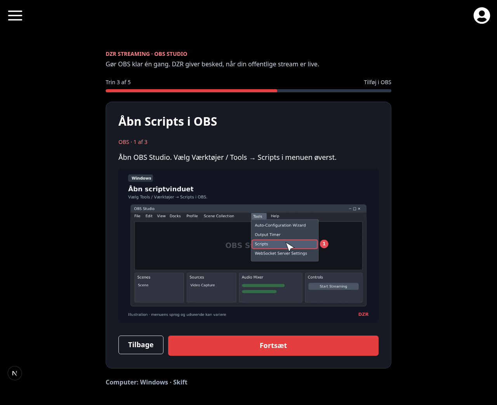
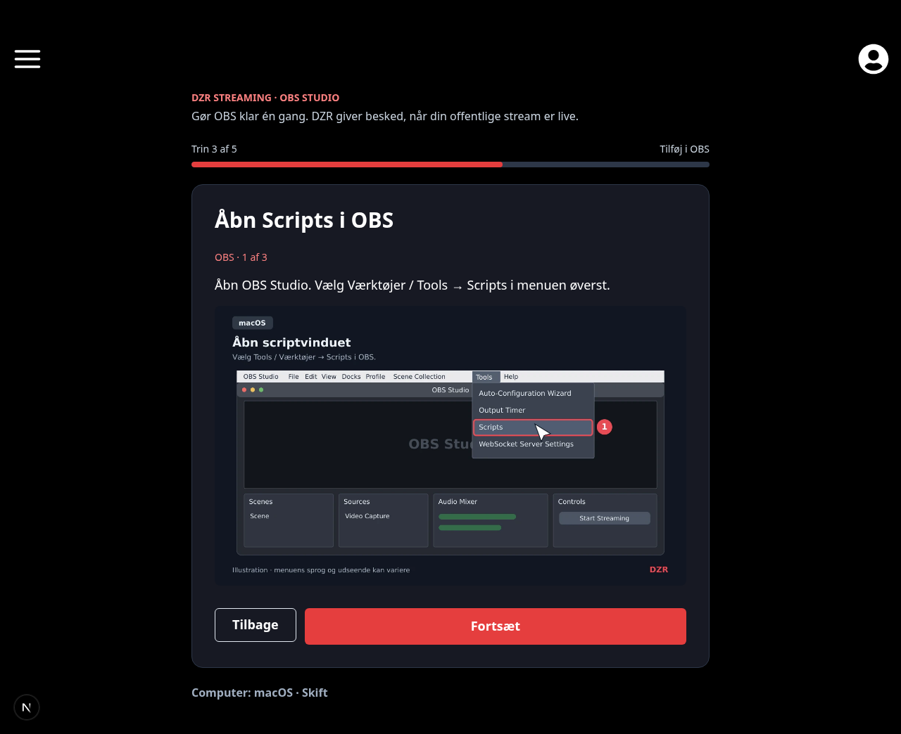
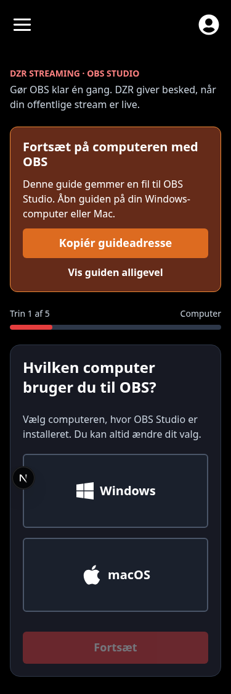

# Test af browserbaseret OBS-onboarding

[Repository-opsætning](../README.md#obs-streaming) · [Streamingarkitektur](architecture/streaming.md)

MVP’en sammenligner den eksisterende `/streaming_add` med `/streaming_add_new`. Begge bruger samme registrering, nøgleformat, Lua-fil, callback og verifikation. Browserguiden kræver ikke login og modtager ingen personlig OBS-nøgle. Automatisk platformregistrering følger det eksisterende Lua-script; der er ingen platformvælger i OBS.

## Preview af browserguiden

Skærmbillederne er fra lokal Chromium-test af den faktiske Next.js-side. OBS-billederne inde i guiden er mærkede illustrationer, ikke native OBS-skærmbilleder. Testen brugte en lokal Lua-filserver og en tom, skrivebeskyttet Firestore-testgrænse; ingen produktionsdata eller personlige nøgler indgår.

| Windows-vejledning | macOS-vejledning | Mobilvejledning |
| --- | --- | --- |
|  |  |  |

## Lokal test fra forken

Brug et rent checkout af feature-branchen uden kopierede produktions-`.env`-filer. Eksemplerne bruger en POSIX-shell; Windows/macOS-accepttesten kan tilgå de lokale tjenester gennem midlertidige HTTPS-adresser. Der behøves ingen ekstra Render-service.

Forudsætninger: Node 22, npm, Java og Firebase CLI til Firestore-emulatoren, samt en separat Discord-testapp og testserver. Installér website-afhængigheder i repositoryets rod med `npm ci` og botafhængigheder med `npm ci --ignore-scripts` fra `apps/bot`. Opret en Club Member-testrolle og en privat kanal til streambeskeder og IT-fejl på testserveren. Invitér kun testbotten dertil; giv den adgang til at se/skrive i testkanalerne, embedde links og læse beskedhistorik.

Start emulatoren fra repositoryets rod i første terminal:

```sh
firebase emulators:start --only firestore --project demo-dzr-streaming
```

Emulatorens projekt er bevidst et `demo-`-projekt. Åbn midlertidig HTTPS-adgang til websiteport 3000 og botport 3001 via dit udviklingsmiljøs preview/portforwarding. Notér de to adresser; botadressen skal være en origin uden sti. HTTPS er nødvendigt for de rigtige OBS-callbacks og browserens mappevælger. Der er ikke behov for at gøre emulatorporten offentligt tilgængelig.

Opret den Git-ignorerede `apps/bot/.env.streaming.local` til teststarteren:

```dotenv
FIRESTORE_EMULATOR_HOST=127.0.0.1:8080
STREAMING_TEST_BOT_TOKEN=TESTAPPENS_TOKEN
STREAMING_TEST_CLIENT_ID=TESTAPPENS_APPLICATION_ID
STREAMING_TEST_GUILD_ID=TESTSERVERENS_ID
STREAMING_TEST_CLUB_ROLE_ID=TESTROLLENS_ID
STREAMING_TEST_CHANNEL_ID=TESTKANALENS_ID
STREAMING_TEST_IT_CHANNEL_ID=TEST_IT_KANALENS_ID
STREAMING_TEST_PUBLIC_URL=https://BOT-HTTPS-ADRESSE
STREAMING_SETUP_URL=https://WEBSITE-HTTPS-ADRESSE/streaming/setup
STREAMING_TEST_PORT=3001
YOUTUBE_API_KEY=API_NOEGLE_TIL_TEST
TWITCH_CLIENT_ID=TWITCH_APP_ID_TIL_TEST
TWITCH_CLIENT_SECRET=TWITCH_APP_SECRET_TIL_TEST
```

Providerindstillinger kræves kun for de platforme, der afprøves. De eksisterende providerintegrationer slår kanaler op og læser offentlig live-status; en lille pilot begrænser brugen af API-kvote. Opbevar alle værdier lokalt og indsæt aldrig tokens i PR, screenshots eller chat.

Start fra `apps/bot` i anden terminal:

```sh
npm run dev:streaming
```

Teststarteren bruger kun streamingfunktionaliteten, kræver en lokal emulator og initialiserer projektet `demo-dzr-streaming` selv. Den kontrollerer testapp, guild, rolle og kanaler, afviser DZR-produktionsguilden, gemmer testrollens medlemskabsindstilling i emulatoren og registrerer streamingkommandoer guild-specifikt på testappen. Den starter ikke de øvrige botjobs. **Kør ikke `node bot.js` til dette formål**: den normale entrypoint registrerer globale kommandoer og starter andre jobs.

### Website uden produktionscredentials

Det fælles website-layout kan skrive manglende felter til Firestore, selv når guiden kun læses. Brug derfor emulator også til websitet. Den eksisterende Firebase-initialisering kræver et syntaktisk gyldigt certifikat, selv med emulator. Følgende starter Next.js med et lokalt genereret testcertifikat i hukommelsen, demo-konfiguration og et begrænset procesmiljø. Ret `botOrigin` til testbot-adressen først. Ingen produktions-Firebase- eller Discord-credentials er nødvendige for den offentlige guide.

Kør fra repositoryets rod i tredje terminal:

```sh
node <<'NODE'
const { generateKeyPairSync, randomBytes } = require('node:crypto')
const { spawn } = require('node:child_process')
const botOrigin = 'https://BOT-HTTPS-ADRESSE'
const { privateKey } = generateKeyPairSync('rsa', {
  modulusLength: 2048,
  privateKeyEncoding: { type: 'pkcs8', format: 'pem' },
  publicKeyEncoding: { type: 'spki', format: 'pem' },
})
const allowed = ['PATH', 'SystemRoot', 'COMSPEC', 'TMPDIR', 'TMP', 'TEMP',
  'HTTP_PROXY', 'HTTPS_PROXY', 'NO_PROXY', 'ALL_PROXY',
  'http_proxy', 'https_proxy', 'no_proxy', 'all_proxy', 'NODE_EXTRA_CA_CERTS']
const testEnv = Object.fromEntries(Object.entries(process.env)
  .filter(([name]) => allowed.includes(name)))
Object.assign(testEnv, {
  FIRESTORE_EMULATOR_HOST: '127.0.0.1:8080',
  FIREBASE_PROJECT_ID: 'demo-dzr-streaming',
  FIREBASE_CLIENT_EMAIL: 'local-test@demo-dzr-streaming.iam.gserviceaccount.com',
  FIREBASE_PRIVATE_KEY: privateKey,
  FIREBASE_STORAGE_BUCKET: 'demo-dzr-streaming.appspot.com',
  NEXT_PUBLIC_FIREBASE_PROJECT_ID: 'demo-dzr-streaming',
  NEXT_PUBLIC_FIREBASE_API_KEY: 'AIzaSy' + '0'.repeat(33),
  NEXT_PUBLIC_FIREBASE_AUTH_DOMAIN: 'demo-dzr-streaming.firebaseapp.com',
  NEXT_PUBLIC_FIREBASE_STORAGE_BUCKET: 'demo-dzr-streaming.appspot.com',
  NEXT_PUBLIC_FIREBASE_MESSAGING_SENDER_ID: '1234567890',
  NEXT_PUBLIC_FIREBASE_APP_ID: '1:1234567890:web:demo-streaming',
  NEXTAUTH_SECRET: randomBytes(32).toString('hex'),
  NEXTAUTH_URL: 'http://localhost:3000',
  STREAMING_PUBLIC_URL: botOrigin,
})
const child = spawn(process.execPath,
  ['node_modules/next/dist/bin/next', 'dev', '--webpack'],
  { env: testEnv, stdio: 'inherit' })
child.on('exit', code => { process.exitCode = code || 0 })
NODE
```

Åbn `/streaming/setup` i et privat browservindue uden at logge ind. Teststarterens `STREAMING_SETUP_URL` skal pege på denne website-instans. Vælg et medlem med testrollen og kør `/streaming_add_new` på testserveren. **Indsæt testbot-adressen i DZR endpoint i OBS, før du tester.** Den generiske Lua-fil har ellers produktionsadressen som standard. OBS-nøglen kopieres direkte fra testbottens private Discord-svar til OBS og skal aldrig indsættes i guiden.

En Vercel-preview fra forken kan bruges, hvis den har separat test-Firebase-konfiguration og peger på testbotten. Den lokale emulator er normalt ikke tilgængelig fra Vercel. Brug ikke produktionscredentials som genvej, og ændr ikke produktionsprojektets domæner eller botkonfiguration for at teste en fork.

## Automatiske kontroller

Kør fra repositoryets rod:

```sh
npm run test:streaming-setup
npm test
npx tsc --noEmit
npm run lint
npm run lint:bot
npm run check:zwift-links
npm run check:shared
```

Kør fra `apps/bot`:

```sh
npm test
npm run eval:dry
```

Lua-transporttesten kræver LuaJIT, libcurl og OpenSSL; `LUAJIT_BIN` kan pege på en lokal LuaJIT-installation. Den markeres som sprunget over, hvis LuaJIT mangler, og må da ikke rapporteres som fuldt valideret. Kør også `npm run build` i det isolerede website-testmiljø samt de eksisterende produktionsaudits i CI. Bot- og installer-tests bruger lokale testdoubles og må ikke oprette produktionsregistreringer eller Discord-beskeder.

Testene skal dække autorisation og komponent-ejerskab, nye/eksisterende registreringer, samtidige indsendelser uden rotation, uændret originalt flow, kanalfejl, downloadfejl, filkonflikter og mappeadgang. Browser-tests med mockede filhandles erstatter ikke de native mappevælgere eller indlæsning af Lua i OBS.

## Manuel accept

Registrér OS, browser, OBS-version og resultat i PR’en. Nedenstående afkrydsninger er en testliste, ikke en påstand om gennemførte native tests.

| Udført | Scenarie | Forventet resultat |
| --- | --- | --- |
| [ ] | Windows + Chrome og Edge | Mappevælger kræver brugerklik og tilladelse. Filen gemmes i valgt DZR-mappe. Billeder og klikvej passer. |
| [ ] | macOS + Chrome og Edge | Samme installation; macOS-vejledning, mappevalg og OBS-menu kontrolleres på rigtig maskine. |
| [ ] | Safari og Firefox | Almindelig download virker; filen kan flyttes til permanent DZR-mappe og tilføjes i OBS. |
| [ ] | Mobil og forkert OS-forslag | Hjælp til at fortsætte på OBS-computeren; link kan kopieres og OS ændres manuelt. |
| [ ] | Ny bruger med YouTube, Twitch eller begge | Mindst én gyldig kanal kræves; én registrering og ny nøgle i et privat svar. |
| [ ] | Eksisterende bruger og genåbnet guide | Ingen nye provideropslag til tilmelding, ingen ændrede kanaler, nøglehash, registrerings-id eller igangværende streamingarbejde. |
| [ ] | To åbne formularer/dobbelt indsendelse | Første oprettelse vinder; den anden får guideadgang uden ny nøgle eller rotation. |
| [ ] | Ingen Club Member-rolle, forkert ejer eller DM | Afvisning uden registrering eller adgang til andres oplysninger. |
| [ ] | Afbrudt mappevalg eller afvist adgang | Ingen falsk installationssucces; neutral besked eller hjælp, prøv igen og downloadalternativ. |
| [ ] | Gentagen installation | Identisk fil kan genbruges; anderledes eksisterende fil overskrives ikke. Valg af selve DZR-mappen opretter ikke DZR/DZR. |
| [ ] | Fil mangler eller er flyttet/slettet | Gendan den på den oprindelige placering og genindlæs i OBS. Geninstallering ændrer ikke nøgle eller kanaler. |
| [ ] | Scriptdownload fejler eller filskrivning afbrydes | Tydelig fejl og retry. Ingen tom fil eller HTML-fejlside rapporteres som installeret script. |
| [ ] | OBS er konfigureret korrekt | DZR endpoint og nøgle fungerer; intet platformvalg er nødvendigt. |
| [ ] | Valgfri test gennemført | Tryk Test forbindelse i OBS og statusknappen i Discord. Et nyt signal med relevant tidspunkt vises uden offentlig annoncering. |
| [ ] | Valgfri test sprunget over | Guiden afsluttes. Browseren skelner fil/guide gennemført fra bekræftet OBS-forbindelse. |
| [ ] | Offentlig teststream | Eksisterende verifikation laver den forventede annonce i testkanalen; en planlagt/offline stream gør ikke. |
| [ ] | Mistet nøgle | Guiden advarer om rotation før henvisning til `/streaming_add`. Eksisterende OBS-nøgle kan beholdes. |
| [ ] | Original `/streaming_add` | Samme private embeds, modal-id’er, nøgleudlevering, rotationsadvarsel, autorisation og statusknap som før MVP’en. |
| [ ] | Tastatur, zoom og lille vindue | Synligt fokus, læsbare billeder, tilbage/næste og fejlbeskeder er brugbare. |
| [ ] | Browserens netværk og lager | Ingen personlig OBS-nøgle i URL, requests, analytics, local/session storage eller IndexedDB; mappenavne/handles sendes ikke til serveren. |

I downloadforløbet kan browseren kun registrere, at filen er hentet. Brugeren bekræfter selv den permanente placering. At guiden er færdig beviser hverken, at OBS har indlæst scriptet, eller at en offentlig livestream er verificeret.

## Sammenligning og selvstændige forbedringer

Lad et lille antal begyndere gennemføre samme opgave med hvert flow i testmiljøet: registrér en kanal og gør OBS klar. Brug nye testregistreringer eller nulstil emulatoren mellem sammenlignelige forsøg. Det gamle flow roterer nøglen, når formularen gemmes; brug ikke en fungerende produktionsopsætning til sammenligningen. Notér gennemførelse, tid, behov for hjælp, filplaceringsfejl, antal Discord-handlinger og om testen blev valgt. Der bygges ingen personlig analytics eller A/B-infrastruktur.

Den nuværende originale onboarding har tre Discord-handlinger før nøgleudlevering: kommando, kanalknap og formularindsendelse. Tre embeds giver mere forklaring end det tidligere flow, men alle afsnit vises samtidig. Nøglen og endpoint står særskilt, og der er allerede en rotationsadvarsel. Det følgende er prioriterede forslag til en senere, uafhængig forbedring; de er ikke implementeret i den gamle brugerrejse i MVP’en.

| Rang | Forslag | Forventet UX-effekt / kompleksitet |
| --- | --- | --- |
| 1 | Tilføj **Vis opsætning** for eksisterende brugere, og adskil kanalredigering fra et særskilt bekræftet nøgleskift. | Meget høj / middel |
| 2 | Brug en permanent filplacering og korte Windows/macOS-installationsafsnit med billeder. Downloads er let at rydde op ved en fejl. | Høj / lav–middel |
| 3 | Giv konkret fejlrecovery og genåbn formularen med kanalinput: skeln mellem forkert link, optaget kanal og driftsfejl. | Høj / middel |
| 4 | Gør testens valgfrihed tydelig, og forklar seneste signaltid kontra verificeret offentlig livestream. | Middel–høj / lav |
| 5 | Undersøg direkte modal inden Discord-fristen for nye brugere. Bevar separate, let markerbare kodefelter for nøgle og endpoint; almindelige Discord-knapper kan ikke kopiere vilkårlig tekst til udklipsholderen. | Middel / lav–middel |

## Udrulning og grænser

Gør først websiteguiden tilgængelig med korrekt bot-origin, og deploy derefter botkommandoen med guideadressen. Start med en lille pilot. Den eksisterende `/streaming_add` kan bruges gennem hele forsøget. Fjernes den nye kommando igen, er registreringerne stadig kompatible med de eksisterende services.

MVP’en omfatter ikke browserlogin, nøgleoverførsel til websitet, automatisk OBS-konfiguration, personlig Lua, scriptopdatering, browserbaseret forbindelsesverifikation, nye registreringsdatabaser eller Linux-illustrationer. Illustrationernes kilder og native verifikationsbehov findes i [billedoversigten](../public/streaming/setup/README.md). PR’en skal målrettes `NickNiebling/dzr:main`, beskrive testresultater og åbne native tests og må ikke merges automatisk.
